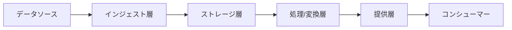

# 調査テンプレート

技術調査資料の標準フォーマットを提供します。

## 概要

このテンプレートを使用して、技術調査の結果を統一されたフォーマットで記録します。

---

## 技術調査レポート テンプレート

```markdown
# [技術名] 調査レポート

**日付**: YYYY-MM-DD  
**調査者**: [名前]  

---

> **記載ガイドライン**: 各セクションは抽象論ではなく実装・運用観点の具体例を含めてください。
> 例: 「スケーラブル」ではなく「オートスケーリングにより、ピーク時に処理ノードを自動拡張可能」のように記述します。
>
> **定量視点の義務付け**: 性能・コスト・SLA・規模の限界は、可能な限り数値で記述します。
> 定量値が公開されていない場合は「非公開」「要問い合わせ」と明記し、推測値を事実として記述してはなりません。

---

## 調査モード

- **既定モード**: 完全非依存モード（背景・目的・要件・制約が未提示でも作成可能）
- **依存モード**: 背景・目的・要件・制約が明示された場合のみ、任意セクションを記入

## 必須（非依存）セクション

- 調査対象（技術概要、主要機能）
- 調査結果（機能評価、一般メリット・デメリット）
- トレードオフ要因（パターン言語の「フォース」）
- 実現難易度（実装・採用の難易度）
- 費用対効果
- 採用の判断基準（採用すべき状況・採用すべきでない場面）
- リスク・アンチパターン（一般論として成立する内容）
- 情報鮮度（出典 URL、取得日、想定バージョン、見直し頻度）

## 任意（依存）セクション

- 調査の背景
- 調査の目的
- 前提・制約
- **調査対象一覧**（tech-options-pickup を前フェーズとして実施した場合のみ。前フェーズで列挙した全選択肢と本レポートでの扱いを一覧で示す）
- 前提条件・依存関係
- 性能評価、制限値・クォータ、コスト構造、コスト感度分析
- ユースケース適合性、運用性・ガバナンス評価、可観測性
- 相互運用性、セキュリティ詳細

---

## 調査の背景（任意: 明示時のみ記入）

[なぜこの技術を調査するのか。何を解決したいのか]

## 調査の目的（任意: 明示時のみ記入）

[この調査で明らかにしたいこと。例: Databricks の機能・制約・リスクを把握する]

- 目的1
- 目的2
- 目的3

## 前提・制約（任意: 明示時のみ記入）

> **この調査結果が有効な条件を明記すること。** 前提が異なる場合は結論も変わりうる。

### 環境

- **クラウド**: Azure / AWS / GCP（該当するものを選択）
- **リージョン**: [例: Japan East]
- **アカウント/サブスクリプション構成**: [例: 本番・開発を分離]

### 規模

- **データ量**: [例: 日次インジェスト 500 GB、累積 50 TB]
- **ユーザー数**: [例: 分析ユーザー 30 名、API 経由アクセス 1,000 req/日]
- **規模感**: 小 / 中 / 大

### 要件

| カテゴリ | 内容 |
|---------|------|
| セキュリティ | [例: 閉域接続必須、RBAC によるアクセス制御] |
| コスト | [例: 月額予算上限、従量課金モデルを優先] |
| 運用性 | [例: 運用担当 2 名、マネージドサービス優先] |
| 可用性 | [例: SLA 99.9% 以上] |

### 制約

- [例: インターネット直接アクセス不可]
- [例: データ居住地要件あり（国内リージョン限定）]
- [例: 既存 IdP との統合必須]

## 調査対象一覧（任意: tech-options-pickup 実施時のみ記入）

> **tech-options-pickup を前フェーズとして実施した場合に記入すること。**
> 前フェーズで列挙した全選択肢を漏れなく記載し、本レポートでの扱い（詳細調査済み・概要のみ・対象外）を明示する。
> 調査優先度は tech-options-pickup の出力をそのまま引用すること。

| 分類 | No. | 選択肢名 | 優先度 | 本レポートでの扱い |
|------|-----|----------|--------|-------------------|
| [カテゴリ名] | [No.] | [選択肢名] | 高 / 中 / 低 | 詳細調査済み / 概要のみ / 対象外 |
| [カテゴリ名] | [No.] | [選択肢名] | 高 / 中 / 低 | 詳細調査済み / 概要のみ / 対象外 |

> **本レポートでの扱いの定義**:
> - **詳細調査済み**: 専用セクションを設けて特性・制約・リスクを記述
> - **概要のみ**: 概要・未調査の理由・採用を検討するケースのみ記述
> - **対象外**: 調査スコープ外として本レポートに記述なし（理由を注記）

## 調査対象

### 技術概要

- **名称**: [製品/技術名]
- **バージョン**: [バージョン]
- **ベンダー**: [提供元]
- **ライセンス**: [ライセンス形態]
- **公式サイト**: [URL]

### 主要機能

- 機能1: [説明]
- 機能2: [説明]
- 機能3: [説明]

### 前提条件・依存関係（任意: 明示時のみ記入）

> **導入前に満たすべき前提と、稼働に必要な外部依存を洗い出すこと。** 前提が欠けると採用可否の判断が変わる。

| 分類 | 項目 | 必須/推奨 | 備考 |
|------|------|----------|------|
| 実行基盤 | [例: 対応 OS / ランタイム / クラウド] | 必須 | [例: Linux x86_64、特定バージョン以上] |
| 依存サービス | [例: 認証基盤、メタストア、オブジェクトストレージ] | 必須 | [例: 既存 IdP と SSO 連携が前提] |
| ネットワーク | [例: 閉域接続、アウトバウンド許可先] | 必須 | [例: 特定エンドポイントへの疎通が必要] |
| ライセンス/契約 | [例: 有償プラン、対象 SKU、同意事項] | 必須 | [例: 該当機能は上位プラン限定] |
| スキル/体制 | [例: 必要な技術スキル、運用体制] | 推奨 | [例: Spark 実務経験者が望ましい] |

- 前提未充足時の影響: [例: メタストアが未整備の場合、初期構築が XX 週間延伸する]

## 調査結果

### アーキテクチャ概要（任意: 明示時のみ記入）



**主要コンポーネント**:

| コンポーネント | 役割 | 具体的な実装例 |
|--------------|------|---------------|
| コンポーネント1 | [役割] | [例: Azure Data Factory でバッチインジェスト] |
| コンポーネント2 | [役割] | [例: Delta Lake でデータストア] |
| コンポーネント3 | [役割] | [例: Databricks SQL でクエリ提供] |

### 機能評価

| 機能 | 対応状況 | 備考 |
|------|---------|------|
| 必須機能1 | ✅ | [詳細] |
| 必須機能2 | ✅ | [詳細] |
| 推奨機能1 | ⚠️ | [制限事項] |
| 推奨機能2 | ❌ | [代替方法] |

### 性能評価（任意: 明示時のみ記入）

| 指標 | 値 | 備考 |
|------|-----|------|
| スループット | XXX req/sec | [条件] |
| レイテンシ | XX ms | [条件] |
| 同時接続数 | XXX | [最大値] |

### 制限値・クォータ（任意: 明示時のみ記入）

> **サービス上限、既定クォータ、引き上げ可否を確認する。** 性能の実効値は上限に律速される場合がある。

| 項目 | 既定値/上限 | 引き上げ可否 | 影響・備考 |
|------|-----------|------------|-----------|
| [例: 同時実行ジョブ数] | [数値] | 可 / 要申請 / 不可 | [例: 上限到達時はキューイング] |
| [例: API レート制限] | [数値/単位時間] | 可 / 要申請 / 不可 | [例: 429 応答・リトライ設計が必要] |
| [例: 1 リソースあたり容量] | [数値] | 可 / 要申請 / 不可 | [例: パーティション設計で回避] |
| [例: リージョン/アカウント上限] | [数値] | 要申請 | [例: 事前申請でリードタイム発生] |

### コスト構造（任意: 明示時のみ記入）

> **TCO（総所有コスト）で評価する。** 月額だけでなく、運用人件費、移行コスト、トレーニングコストも含める。

| 項目 | コスト | 条件・備考 |
|------|--------|----------|
| 初期費用（ライセンス・セットアップ） | [数値] | [通貨・単位を明記] |
| 月額固定費 | [数値] | [通貨・単位を明記] |
| 従量課金（ストレージ） | [数値] | [例: /TB、/GB] |
| 従量課金（処理） | [数値] | [例: /時間、/処理単位] |
| 運用人件費（月額換算） | [数値] | [工数と単価を明記] |
| 移行・初期構築コスト | [数値] | 一時費用 |
| **月額 TCO 推定** | **[数値]** | [規模・条件・通貨を明記] |

**コスト最適化のポイント**:

- [例: 予約インスタンス (1 年) で約 40% 削減可能]
- [例: オートスケーリング設定でアイドル時のコンピューティングを自動停止]

### コスト感度分析（任意: 明示時のみ記入）

| シナリオ | 前提条件 | 月額TCO | ベース比 | 備考 |
|---|---|---:|---:|---|
| ベースライン | [通常時の負荷・単価] | [数値] | 0% | |
| 需要増（+50%） | [ピーク時想定] | [数値] | +XX% | |
| 価格改定（+20%） | [主要課金項目の単価上昇] | [数値] | +XX% | |
| 最適化適用 | [自動停止/予約/キャッシュ最適化等] | [数値] | -XX% | |

- コストドライバー: [例: コンピュート利用時間、データスキャン量、外部転送料]
- 閾値: [例: 月額TCOが予算の 90% を超えたら運用モードを見直す]
- 監視指標: [例: 日次コスト、単位処理あたりコスト、ピーク時コスト]

### ユースケース適合性（任意: 明示時のみ記入）

> **自プロジェクトのユースケースに対して評価すること。** 一般論ではなく前提セクションに記載した条件を基準にする。

| ユースケース | 適合度 | 具体的な実装アプローチ |
|------------|--------|---------------------|
| バッチデータ処理 | ✅ 適合 | [例: Spark ジョブで日次 ETL] |
| リアルタイム分析 | ⚠️ 条件付き | [例: Structured Streaming、ただし追加コスト発生] |
| ML モデル学習 | ✅ 適合 | [例: MLflow 統合でモデル管理] |
| セルフサービス BI | ❌ 不適合 | [例: Power BI との接続遅延が課題] |

### 運用性・ガバナンス評価（任意: 明示時のみ記入）

| 観点 | 評価 | 具体的な内容 |
|------|------|------------|
| セットアップの容易さ | ⭐⭐⭐⭐ | [例: IaC で短時間に構築可能] |
| 運用の複雑さ | ⭐⭐⭐ | [例: クラスター管理に専任担当が必要] |
| モニタリング | ⭐⭐⭐⭐ | [例: 監視基盤との標準統合] |
| ドキュメント | ⭐⭐⭐⭐⭐ | |
| データリネージュ | ⭐⭐⭐ | [例: テーブル単位のリネージュ追跡] |

> **セキュリティ・コンプライアンス（RBAC、認証・認可、監査ログ、準拠要件）は「セキュリティ詳細」セクションに集約すること。** 本表は運用容易性の観点に限定する。

### 可観測性（Observability）（任意: 明示時のみ記入）

> **メトリクス、ログ、トレースの取得可否とアラート設計を確認すること。** 上表「モニタリング」の評価を実装方式まで具体化する。

| 観点 | 取得可否 | 実装方式 | 備考 |
|------|---------|---------|------|
| メトリクス | ✅ / ⚠️ / ❌ | [例: Prometheus エクスポート、標準ダッシュボード] | [例: 主要指標を分単位で取得] |
| ログ | ✅ / ⚠️ / ❌ | [例: 監視基盤へ転送、構造化ログ] | [例: 保管期間と転送遅延を明記] |
| トレース | ✅ / ⚠️ / ❌ | [例: OpenTelemetry 対応] | [例: 分散トレースの対応範囲] |
| アラート | ✅ / ⚠️ / ❌ | [例: 閾値・異常検知、通知先連携] | [例: 通知経路とエスカレーション] |

- 主要監視指標（SLI）: [例: 成功率、レイテンシ p95、処理遅延、日次コスト]
- ダッシュボード・可視化: [例: 標準提供の有無、カスタム作成の要否]
- 未対応の観点と代替策: [例: トレース非対応のため、ログ相関で追跡を代替]

## 他製品との相互運用性（任意: 明示時のみ記入）

> **実際に連携が必要なシステムとの統合可否を確認すること。** 「対応予定」は非対応として扱う。

| 連携先 | 連携方式 | 対応状況 | 備考 |
|--------|---------|---------|------|
| [既存 DWH / DB] | [例: JDBC / ODBC] | ✅ | [例: 標準コネクタで接続可能] |
| [BI ツール] | [例: DirectQuery / Import] | ✅ | [例: Power BI Connector 提供] |
| [データカタログ] | [例: REST API] | ⚠️ | [例: カスタム実装が必要] |
| [認証基盤（AD/IdP）] | [例: SAML / OAuth2] | ✅ | [例: 既存 IdP SSO 対応] |
| [メッセージキュー] | [例: Kafka / Queue Service] | ✅ | [例: ストリーム処理で接続] |
| [オーケストレーター] | [例: Airflow / ADF] | ✅ | [例: 公式 Operator 提供] |

## メリット・デメリット

### メリット ✅

- メリット1: [具体的な実装・運用上の利点]
- メリット2: [具体的な実装・運用上の利点]
- メリット3: [具体的な実装・運用上の利点]

### デメリット ❌

- デメリット1: [具体的な課題と影響範囲]
- デメリット2: [具体的な課題と影響範囲]
- デメリット3: [具体的な課題と影響範囲]

## トレードオフ要因

> パターン言語の「フォース（forces）」を記述する。フォースとは、同時には満たしにくく互いに対立する要求や制約であり、この技術がそのバランスをどう取るかを示す。技術ごとに記述する（比較時は見出しに技術名を付す）。

| フォース | 対立する要求 A | 対立する要求 B | この技術のバランスの取り方 |
|------|---------------|---------------|----------------------|
| [例: 開発速度 vs 安定性] | [要求 A の具体内容] | [要求 B の具体内容] | [どちらに重きを置く設計かとその理由] |
| [例: コスト vs 性能] | [要求 A の具体内容] | [要求 B の具体内容] | [どちらに重きを置く設計かとその理由] |
| [例: 柔軟性 vs 学習コスト] | [要求 A の具体内容] | [要求 B の具体内容] | [どちらに重きを置く設計かとその理由] |

- 未解決のフォース: [この技術でも完全には解消できていない対立関係と、利用者側での対応方針]

## 実現難易度

> 導入から運用開始までの難易度を評価する。技術的な学習コストに加え、組織の習熟度や既存システムとの統合コストも含める。技術ごとに記述する（比較時は見出しに技術名を付す）。

| 観点 | 難易度 | 具体的な内容 |
|------|--------|------------|
| 学習コスト | ⭐⭐⭐ | [例: 独自 DSL の習得に 2 週間程度を要する] |
| 初期構築の複雑さ | ⭐⭐ | [例: IaC テンプレートで半日程度で構築可能] |
| 既存システムとの統合 | ⭐⭐⭐⭐ | [例: 既存認証基盤との統合に追加開発が必要] |
| 必要なスキルセット | ⭐⭐⭐ | [例: Spark/Scala の実務経験者が望ましい] |
| 移行・切替の複雑さ | ⭐⭐⭐ | [例: 既存データの形式変換が必要] |

- 総合評価: [実現難易度の総合的な評価と、導入までのリードタイム目安]

## 費用対効果

> 導入コスト（実現難易度とコスト構造）に対する効果を評価する。定性的効果に加え、可能な限り定量指標で示す。技術ごとに記述する（比較時は見出しに技術名を付す）。

| 効果 | 内容 | 定量指標（可能な場合） |
|------|------|----------------------|
| コスト削減効果 | [例: 運用工数削減] | [例: 月間 XX 時間 → YY 時間] |
| 性能・スループット向上 | [例: 処理時間短縮] | [例: XX 分 → YY 分] |
| 収益・ビジネス価値 | [例: 意思決定の迅速化] | [例: レポート作成 週次 → 日次] |
| リスク低減効果 | [例: 障害復旧時間短縮] | [例: RTO XX 分 → YY 分] |

- 投資回収期間（目安）: [例: 導入コスト XXX 万円に対し、月間コスト削減 YY 万円で回収期間 ZZ か月]
- 費用対効果の判定: 高 / 中 / 低（[判定理由]）

> 選択肢間の費用対効果の**比較・最終判定**は ADR の `Comparison`（コスト比較・評価サマリー）で行う。
> このセクションは単一技術の事実評価に限定する。

## 採用の判断基準

> 一般的な技術特性に基づく判断基準を記述する。プロジェクト固有の適合性は「ユースケース適合性」で扱う。「トレードオフ要因」「実現難易度」「費用対効果」を踏まえ、どの条件で採用可否が決まるかを示す。技術ごとに記述する（比較時は見出しに技術名を付す）。
> プロジェクトとして**実際に採用するかどうかの最終判断**は ADR の `Decision` セクションで行う。

### 採用すべき状況 ✅

- 状況1: [具体的な条件（規模・要件・制約）とその理由]
- 状況2: [具体的な条件（規模・要件・制約）とその理由]
- 状況3: [具体的な条件（規模・要件・制約）とその理由]

### 採用すべきでない場面 ❌

- 場面1: [具体的な条件とその理由、代替候補があれば明記]
- 場面2: [具体的な条件とその理由、代替候補があれば明記]
- 場面3: [具体的な条件とその理由、代替候補があれば明記]

## リスク・アンチパターン

> 未指定時は、特定クラウドや製品機能を前提にせず、一般論として成立するリスクと軽減策を記述すること。

### 既知のリスク

| リスク | 影響度 | 発生確率 | 軽減策 |
|--------|--------|---------|-------|
| [例: ベンダーロックイン] | 高 | 中 | [例: Delta Lake 準拠で可搬性を確保] |
| [例: コスト超過] | 高 | 中 | [例: コスト上限アラートと自動停止を設定] |
| [例: スキル不足による運用障害] | 中 | 高 | [例: 運用手順書の整備とオンコール体制] |

### 避けるべきアンチパターン

- **[アンチパターン1]**: [例: 開発・本番を同一クラスターで運用] → [問題点: 本番影響のリスク] → [代替: 環境分離 + Spot インスタンスで開発コスト削減]
- **[アンチパターン2]**: [例: データ量を考慮せず全列を SELECT *] → [問題点: スキャンコスト増大] → [代替: Partition pruning と列絞り込みを徹底]
- **[アンチパターン3]**: [例: IAM ロールに AdministratorAccess を付与] → [問題点: 最小権限原則違反] → [代替: ユースケース別に最小権限ロールを定義]

### 障害モードと復旧手順

| 障害モード | 検知方法 | 影響範囲 | 一次対応 | 復旧手順 | 目標復旧時間 |
|---|---|---|---|---|---|
| [例: データ取り込み停止] | [監視アラート/ログ] | [例: 当日データ欠損] | [例: ジョブ停止・隔離] | [例: チェックポイント復元→再実行] | [例: 60分] |
| [例: 認証基盤障害] | [認証失敗率上昇] | [例: 利用者ログイン不可] | [例: フェイルオーバー切替] | [例: IdP復旧後にトークン再発行] | [例: 30分] |
| [例: コスト暴騰] | [日次コスト急増アラート] | [例: 予算超過] | [例: 高コスト処理を自動停止] | [例: 原因クエリ特定→制限再設定] | [例: 120分] |

- 連絡体制: [オンコール担当、エスカレーション経路]
- 復旧判定条件: [サービスレベル指標が閾値内に戻ること]
- 事後対応: [ポストモーテム、恒久対策、再発防止チケット化]

## セキュリティ詳細（任意: 明示時のみ記入）

> **機微情報の保護、アクセス制御、監査、脅威対策を本セクションに一元化する。** 「運用性・ガバナンス評価」や「リスク・アンチパターン」と重複させない。

### データ分類と保護

- データ分類: [公開 / 社内限定 / 機微情報 / 個人情報]
- 保存時暗号化: [方式、鍵管理サービス、鍵ローテーション周期]
- 転送時暗号化: [TLSバージョン、証明書管理方針]
- マスキング/匿名化: [適用対象、方式、適用タイミング]

### アクセス制御

| 項目 | 方針 | 実装 |
|---|---|---|
| 認証 | [SSO/MFA必須] | [IdP連携方式] |
| 認可 | [最小権限] | [RBAC/ABACの設計] |
| 特権管理 | [JIT/JEA] | [昇格フロー・承認経路] |
| サービス間認証 | [短期資格情報] | [マネージドID/ローテーション] |

### 監査・コンプライアンス

- 監査ログ対象: [認証、権限変更、データ参照、設定変更]
- 保管期間: [例: 400日]
- 改ざん耐性: [WORM/分離保管]
- 準拠要件: [例: SOC2、ISO27001、社内基準]

### 脅威と対策

| 脅威 | 想定攻撃 | 対策 | 残余リスク |
|---|---|---|---|
| [例: 権限昇格] | [誤設定悪用] | [定期棚卸し、自動検知] | [低/中/高] |
| [例: 秘密情報漏えい] | [平文保管] | [シークレット管理基盤] | [低/中/高] |

## 移行計画とロールバック

> **このセクションは ADR の `Implementation Notes` に移動した。**
> 採用を決定した技術に対する移行方針・マイルストン・Go/No-Go 基準・ロールバック計画は、ADR で記述すること。
> 個別技術の調査段階（未採用の候補を含む）では記述しない。

## 次のアクション

> 調査の継続タスク（追加検証・情報収集・PoC など）を記載する。採用後の導入・実装タスクは ADR の `Implementation Notes` で管理する。

- [ ] アクション1
- [ ] アクション2

## 情報鮮度の記録（必須）

- 根拠情報の取得日: [YYYY-MM-DD]
- 想定製品バージョン: [バージョン / 不明]
- 更新トリガー条件: [例: メジャーリリース、価格改定、ポリシー変更]
- 見直し推奨頻度: [例: 3-6 か月ごと]

## 参考資料

- [公式ドキュメント](URL)
- [技術ブログ記事](URL)
```

---

## 使用方法

1. 技術調査レポート テンプレートをコピー
2. `research/` 配下の適切なディレクトリに配置
3. すべてのセクションを記入

---

最終更新: {{ git_revision_date_localized }}
